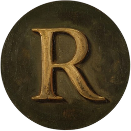

<div align="center">



# René Descartes
### *«Pienso, luego existo»*

**Un museo digital interactivo sobre el filósofo que convirtió la geometría en álgebra**


<!-- ✏️ ENLACE DE LA PÁGINA: si tu enlace es distinto, cámbialo aquí -->
🌐 **[Ver la página en vivo](https://davila00007.github.io/rene-descartes/)**

</div>

---

## 🔗 Enlace de la página

<!-- ✏️ Pega aquí el enlace definitivo que te da GitHub Pages (Settings → Pages) -->
**👉 https://davila00007.github.io/rene-descartes/**

> Si el enlace aún no abre, espera unos minutos después de publicar en GitHub Pages.

---

## 📜 Sobre el proyecto

Este sitio web es el **proyecto final de la Electiva *Matemáticos de la historia con IA***. El reto consistía en usar herramientas de inteligencia artificial de forma **crítica y creativa** para investigar, producir y divulgar la vida y los aportes de un matemático de la historia.

El personaje asignado fue **René Descartes (1596–1650)**: filósofo, científico y, sobre todo, matemático. Sentó las bases de la **geometría analítica**, la idea que hoy está detrás de cada gráfica, mapa y videojuego.

> No es una ficha biográfica: es un sitio de divulgación pensado para **informar, enseñar y atraer** al visitante.

| | |
|---|---|
| 🎓 **Curso** | Electiva: Matemáticos de la historia con IA |
| 👤 **Autor** | Michael Davila O. |
| 🎤 **Presentación** | Martes 17 de noviembre de 2026 |
| 🧮 **Personaje** | René Descartes |

---

## ✨ ¿Qué encontrarás en la página?

La experiencia combina tres ideas: **un libro científico antiguo, un museo digital y una página web moderna**.

| # | Sección | Qué hace |
|:-:|---|---|
| 1 | 🏛️ **Inicio** | Presentación con el retrato de Descartes, su frase más famosa y una animación de entrada. |
| 🎬 | **Descartes se presenta** | Video en el que Descartes, recreado con IA, habla en primera persona sobre su vida y sus ideas. |
| 2 | 📖 **Biografía** | Su vida contada en tarjetas: familia, formación, viajes, obras y últimos años. |
| 3 | ⏳ **Línea de tiempo** | 13 momentos clave, de 1596 a 1650. Haz clic en cada año para ver qué pasó. |
| 4 | 📐 **Aportes a las matemáticas** | Geometría analítica, coordenadas, álgebra de segmentos y regla de los signos, con un **ejemplo resuelto paso a paso** y un **plano cartesiano interactivo**. |
| 5 | 🌍 **Impacto hoy** | Cómo sus ideas viven en la física, la ingeniería, los videojuegos y el GPS, separando la influencia directa de las aplicaciones modernas. |
| 6 | 🎧 **Podcast** | *La duda de Descartes*, un episodio de unos 5 minutos. |
| 7 | 🎮 **Juego interactivo** | *El desafío de Descartes*: un quiz de 10 preguntas con respuesta inmediata, puntaje y opción de volver a jugar. |
| 8 | 💭 **Datos curiosos** | Los tres sueños que tuvo en 1619 y que, según él, cambiaron su vida. |
| 9 | 📚 **Fuentes** | Referencias académicas en formato APA. |
| 10 | 🤖 **Uso de IA** | Tabla transparente de qué herramienta se usó para qué. |

### 🕹️ Funciones interactivas

- 🧭 Menú que se adapta al celular y marca la sección en la que estás.
- 📊 Barra de progreso de lectura en la parte superior.
- 🌀 Elementos que aparecen con animaciones suaves al bajar por la página.
- 📍 Plano cartesiano en el que tocas un punto y ves sus coordenadas al instante.
- ⏳ Línea de tiempo que se recorre con clics o con las flechas del teclado.
- 🏆 Quiz con puntaje y mensaje final según el resultado.
- 📱 Diseño adaptable a computador, tablet y celular.
- ♿ Accesibilidad: buen contraste, textos alternativos en las imágenes y navegación con teclado.

---

## 🎨 Dirección visual

El diseño se inspira en el **Renacimiento tardío y la Europa intelectual de los siglos XVI y XVII**:

- **Paleta:** pergamino, marfil, rojo oscuro, verde profundo, azul apagado y dorado envejecido.
- **Tipografías:** *Cormorant Garamond* para los títulos, con aire de libro antiguo, y *Lora* para el texto, cómoda de leer.
- **Detalles:** marcos dorados, textura de papel y ejes cartesianos decorativos.

---

## 🤖 Uso de inteligencia artificial

La IA fue una **herramienta de apoyo, no un reemplazo del trabajo**. Toda la información se verificó en fuentes académicas antes de publicarla.

### Herramientas de inteligencia artificial

| Herramienta | Uso en el proyecto |
|---|---|
| **Claude** | Desarrollo de la página web y del código HTML, CSS y JavaScript |
| **ChatGPT** | Ingeniería de prompts, organización de ideas y planificación |
| **Perplexity** | Investigación y búsqueda de fuentes |
| **NotebookLM** | Síntesis de fuentes y creación del podcast |
| **Microsoft Copilot** | Guion del video |
| **ElevenLabs** | Voz de Descartes en el video |
| **VisionStory** | Animación del personaje en el video |
| **Clipchamp** | Subtítulos del video |
| **Gemini** | Logo de la página |

### Herramientas de desarrollo y publicación *(no son IA)*

| Herramienta | Uso en el proyecto |
|---|---|
| **Visual Studio Code** | Edición y organización del código |
| **Git** | Control de versiones |
| **GitHub Pages** | Publicación de la página |

### ⚖️ Compromisos de uso responsable

- ✅ Se verificaron fechas, nombres y obras, porque la IA puede inventar información.
- ✅ El video está marcado como **recreación generada con IA**, no como una grabación histórica.
- ✅ El retrato del inicio es una pintura histórica (a partir de Frans Hals, Museo del Louvre), no una imagen de IA.
- ✅ Se citan las fuentes reales consultadas, no solo las herramientas.

---

## 🗂️ Estructura del proyecto

```text
rene-descartes/
│
├── index.html                 → Estructura y contenido de la página
├── style.css                  → Diseño, colores, animaciones y versión para celular
├── script.js                  → Interactividad: menú, línea de tiempo, plano y quiz
├── README.md                  → Este archivo
│
├── images/
│   ├── descartes.webp         → Retrato de Descartes (a partir de Frans Hals)
│   ├── descartesia.webp       → Portada del video
│   ├── paisaje-massys.webp    → Pintura de Cornelis Massys (ambientación)
│   ├── favicon.png            → Ícono de la pestaña
│   └── apple-touch-icon.png   → Ícono para celulares
│
├── audio/
│   └── La_duda_de_Descartes.m4a   → Podcast
│
└── video/
    └── ReneDescartes.mp4          → Video de Descartes recreado con IA
```

> 💡 **¿Quieres cambiar algo?** Las preguntas del quiz están en el arreglo `QUIZ` y los acontecimientos de la línea de tiempo en el arreglo `TIMELINE`, ambos en `script.js`. Los colores se cambian en las variables al inicio de `style.css`.

---

## 🚀 Cómo ejecutarlo en tu computador

1. **Descarga o clona** este repositorio:
   ```bash
   git clone https://github.com/Davila00007/rene-descartes.git
   ```
2. **Abre la carpeta** en Visual Studio Code: *Archivo → Abrir carpeta*.
3. **Inicia la página** con la extensión **Live Server**: clic derecho sobre `index.html` → *Open with Live Server*.
   También puedes hacer doble clic en `index.html` para abrirlo en el navegador.

No necesita instalaciones, frameworks ni servidor: es HTML, CSS y JavaScript puro.

---

## 🌐 Cómo publicarlo en GitHub Pages

1. Crea un repositorio **público** en GitHub llamado `rene-descartes`.
2. Desde la carpeta del proyecto, en la terminal:
   ```bash
   git init
   git add .
   git commit -m "Página de René Descartes"
   git branch -M main
   git remote add origin https://github.com/Davila00007/rene-descartes.git
   git push -u origin main
   ```
3. En GitHub, ve a **Settings → Pages**. En **Branch** elige `main` y la carpeta `/ (root)`, y guarda.
4. En uno o dos minutos la página estará en `https://davila00007.github.io/rene-descartes/` 🎉

> ⚠️ GitHub no acepta archivos de más de **100 MB**. El video pesa unos 55 MB, así que se sube sin problema, aunque Git mostrará una advertencia.

---

## 📚 Fuentes principales

- American Mathematical Society. (2008). *Descartes' dreams*. *Notices of the American Mathematical Society, 55*(1).
- Ayerbe Toledano, J. M. (2017). El nacimiento de la geometría analítica. *Lecturas Matemáticas, 38*(2), 93–124.
- Domski, M. (2025). Descartes' mathematics. En E. N. Zalta y U. Nodelman (Eds.), *The Stanford Encyclopedia of Philosophy*.
- Hatfield, G. (2021). René Descartes. En E. N. Zalta (Ed.), *The Stanford Encyclopedia of Philosophy* (Winter 2021 Edition).
- Otaiku, A. I. (2018). Did René Descartes have exploding head syndrome? *Journal of Clinical Sleep Medicine, 14*(4), 675–678.
- Rocha Herrera, L. (2004). Descartes y el significado de la filosofía mecanicista. *Revista Digital Universitaria, 5*(3).

La lista completa, con enlaces, está en la sección **Fuentes** de la página.

---

<div align="center">

*«Dividir cada una de las dificultades que examinare en tantas partes como fuere posible.»*<br>
— Segunda regla del método, *Discurso del método* (1637)

**Proyecto académico sin fines comerciales · 2026**

</div>
